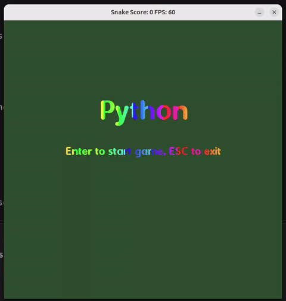

# Python: a Snake game with sprites (CPPND Capstone)

A Snake game written in C++17 with SDL2 for the capstone project of the
[Udacity C++ Nanodegree Program](https://www.udacity.com/course/c-plus-plus-nanodegree--nd213).
It extends the starter project, which was inspired by
[this](https://codereview.stackexchange.com/questions/212296/snake-game-in-c-with-sdl)
Code Review post.



## Features

* A start screen, the game itself and a "Game Over" screen. All text is drawn
  with SDL_ttf, the titles are painted with a flowing rainbow gradient.
* The snake is drawn with sprites: a head (a separate sprite for every turn), a
  body (straight pieces and corners) and a tail. The snake starts with three
  cells and is never shorter than that.
* Fruits (a random one each time) make the snake longer, faster and give a point.
* Poison appears and disappears at random places, in a thread of its own. Eating
  it costs a point and makes the snake shorter (not below three cells).
  Poisons never appear on the fruit, on the snake or on each other.
* The score is shown in the corner of the screen and in the window title.
* The snake wraps around the borders of the board and dies when it bites itself.
* A thread-safe logger with log levels (`src/logging.h`).

## Controls

| Key | Start screen | Game | Game Over screen |
|---|---|---|---|
| Arrow keys | | steer the snake | |
| Enter | start a new game | | back to the start screen |
| Esc | exit | finish the round | exit |

## Dependencies for Running Locally

* cmake >= 3.7
* make
* gcc/g++ with C++17 support (gcc >= 8, because of `<filesystem>`)
* pkg-config
* SDL2 >= 2.0 and SDL2_ttf

On Debian/Ubuntu:

```
sudo apt install build-essential cmake pkg-config libsdl2-dev libsdl2-ttf-dev
```

## Basic Build Instructions

1. Clone this repo.
2. Make a build directory in the top level directory: `mkdir build && cd build`
3. Compile: `cmake .. && make`
4. Run it: `./SnakeGame`

CMake copies the `assets` directory next to the executable, the game looks for
its sprites and the font there.

## Code structure

| Files in `src/` | Role |
|---|---|
| `main.cpp` | Sets the log level, creates `Renderer`, `Controller`, `Game` and starts the game loop |
| `game.h/.cpp` | `Game`: the game loop and the state machine (`game_state.h`), owns the snake, the food, the poisons and the spawner |
| `controller.h/.cpp` | Reads the keyboard; what a key does depends on the game state |
| `snake.h/.cpp` | `Snake`: the cells of the snake, movement and growth |
| `snake_sprites.h/.cpp` | Chooses a sprite for every cell of the snake with a single table (part, side where the snake comes from, side where it goes) |
| `item.h`, `fruit.*`, `poison.*` | Abstract `Item` and its two kinds, `Fruit` and `Poison` |
| `poison_field.*` | The poisons that are on the board now |
| `poison_spawner.*`, `message_queue.h` | The spawner thread and the queue it uses to send new poisons to the game thread |
| `renderer.*`, `text_renderer.*`, `texture.*`, `SDL-extras.h` | Drawing, text, textures; RAII helpers for SDL resources |
| `logging.*` | Thread-safe logging with levels |

### How the threads work

The game loop runs in the main thread. `PoisonSpawner` runs a second thread that
sleeps for a random time (3-8 s), makes a poison with a random cell and
lifetime (4-8 s) and puts it into a `MessageQueue`. At the beginning of every
`Game::Update` the game thread takes everything from the queue and puts a poison
on the board only if the cell is free and there are fewer than three poisons.
The board itself is therefore touched by one thread only and needs no lock. The
thread is interruptible: its sleep is `std::future::wait_for`, and the destructor
wakes it up through the matching `std::promise`.

## Rubric points

README (3 points): this file describes the project, the build instructions and
how the rubric is addressed.

Compiling: `cmake .. && make` builds without errors or warnings with
`-Wall -Wextra`.

### Loops, Functions, I/O

| Point | Where |
|---|---|
| The project demonstrates an understanding of C++ functions and control structures | The game loop `game.cpp:32`, the state `switch` `game.cpp:49`, the direction `switch` `snake.cpp:22`, the sprite loops `snake_sprites.cpp:149` |
| The project accepts input from a user and processes the input | `Controller::HandleInput`, `controller.cpp:14` (`SDL_PollEvent`) |
| The project reads data from a file and processes the data | Sprites and the font are read from the `assets` directory: `texture.cpp:6` (BMP files), `text_renderer.cpp:6` (TTF font), `snake_sprites.cpp:56` and `renderer.cpp:56` (every `.bmp` of a directory, `std::filesystem::directory_iterator`) |
| The project uses data structures and immutable variables | `std::map` with a `std::tuple` key `snake_sprites.cpp:17`, `std::unordered_map` of textures `renderer.h:43`, `constexpr` constants `main.cpp:8`, `poison_spawner.cpp:9`, `snake.h:13` |

### Object Oriented Programming

| Point | Where |
|---|---|
| Classes with appropriate access specifiers | All classes in `src/*.h`, for example `PoisonField` (`poison_field.h`): public interface, private storage |
| Constructors use member initialization lists | `game.cpp:11`, `poison.cpp:3`, `fruit.cpp:9`, `poison_spawner.cpp:15` |
| Classes abstract implementation details from their interfaces | `SnakeSprites` exposes `Draw` only, the table and the geometry helpers are private; `MessageQueue` hides the mutex |
| Classes encapsulate behavior | `PoisonField`, `Texture`, `TextRenderer`, `Logging` |
| Classes follow an appropriate inheritance hierarchy with virtual and override functions | `Item` (`item.h:11`) is an abstract base with the pure virtual `Apply` and `SpriteName`, `Fruit` (`fruit.h:8`) and `Poison` (`poison.h:10`) override them. `Game` holds the food as `std::unique_ptr<Item>` and calls `Apply` without knowing the kind |
| Overloaded functions or operators | `operator==` and `operator!=` for `SDL_Point` in `SDL-extras.h:12`, `Logging::Line::operator<<` `logging.h:40` |
| Templates generalize functions or classes | `MessageQueue<T>` `message_queue.h:8`, `Logging::Line::operator<<` `logging.h:39` |

### Memory Management

| Point | Where |
|---|---|
| The project makes use of references in function declarations | `const Snake &`, `const Item &`, `const std::vector<SDL_Point> &` in `renderer.h:22`, `const SDL_Point &` in `poison_field.h`, `snake_sprites.h:33` |
| The project uses destructors appropriately | `TextRenderer::~TextRenderer` `text_renderer.cpp:12` closes the font, `PoisonSpawner::~PoisonSpawner` `poison_spawner.cpp:20` stops and joins the thread, `Renderer::~Renderer` releases the SDL objects in the right order |
| The project uses scope / RAII | `SurfacePtr` and `TexturePtr` (`unique_ptr` with a custom deleter) `SDL-extras.h:7`, `Texture`, `TextRenderer`, `std::lock_guard` in `message_queue.h:12` and `logging.cpp:54` |
| The project follows the Rule of 5 | `Texture` `texture.h:13-20` and `TextRenderer` `text_renderer.h:23-26` declare destructor, copy and move operations explicitly |
| The project uses move semantics | `MessageQueue::Send(T &&)` `message_queue.h:11`, `std::move` of poisons `game.cpp:126`, `poison_field.cpp:8`, movable `Texture` `texture.h:19` |
| The project uses smart pointers instead of raw pointers | `std::unique_ptr<Item>` `game.h:31`, `std::vector<std::unique_ptr<Poison>>` `poison_field.h:32`, `std::unique_ptr<SnakeSprites>` and the fonts `renderer.h:42` |

### Concurrency

| Point | Where |
|---|---|
| The project uses multithreading | `PoisonSpawner` runs its own `std::thread`, `poison_spawner.cpp:17` |
| A promise and future is used in the project | `std::promise<void> _stop` and `std::future<void> _stop_future` `poison_spawner.h:40-41`; the thread sleeps in `wait_for` `poison_spawner.cpp:40`, the destructor calls `set_value` `poison_spawner.cpp:21` |
| A mutex or lock is used in the project | `MessageQueue` `message_queue.h:12`, `Logging` `logging.cpp:54` (`std::mutex` with `std::lock_guard`); `std::atomic` for the log level `logging.h:62` and for the spawner switch `poison_spawner.h:37` |

The program was also run under ThreadSanitizer
(`-fsanitize=thread`): it reports nothing in this code, only warnings that come
from system libraries (Mesa, D-Bus).

## Assets and credits

* The sprites (snake, fruits, poison) are in `assets/`. The graphics were made
  with the help of AI image generation and finished by hand in GIMP. The
  sources are in `graphics/`.
* The font is Dyuthi Regular by Swathanthra Malayalam Computing
  (`assets/fonts/Dyuthi-Regular.ttf`), licensed under GPL-3.0+ with the Font
  Exception or OFL-1.1.
* `assets/grass/` is a set of grass tiles that is not used by the game any more.

## CC Attribution-ShareAlike 4.0 International

Shield: [![CC BY-SA 4.0][cc-by-sa-shield]][cc-by-sa]

This work is licensed under a
[Creative Commons Attribution-ShareAlike 4.0 International License][cc-by-sa].

[![CC BY-SA 4.0][cc-by-sa-image]][cc-by-sa]

[cc-by-sa]: http://creativecommons.org/licenses/by-sa/4.0/
[cc-by-sa-image]: https://licensebuttons.net/l/by-sa/4.0/88x31.png
[cc-by-sa-shield]: https://img.shields.io/badge/License-CC%20BY--SA%204.0-lightgrey.svg
